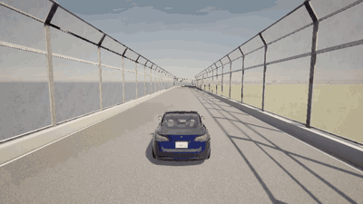
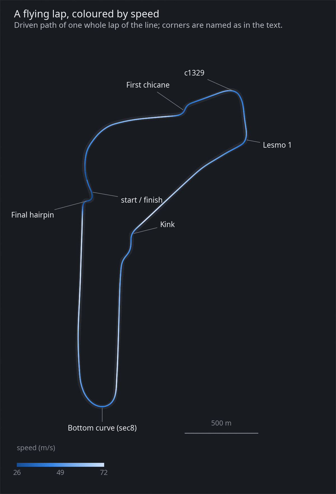
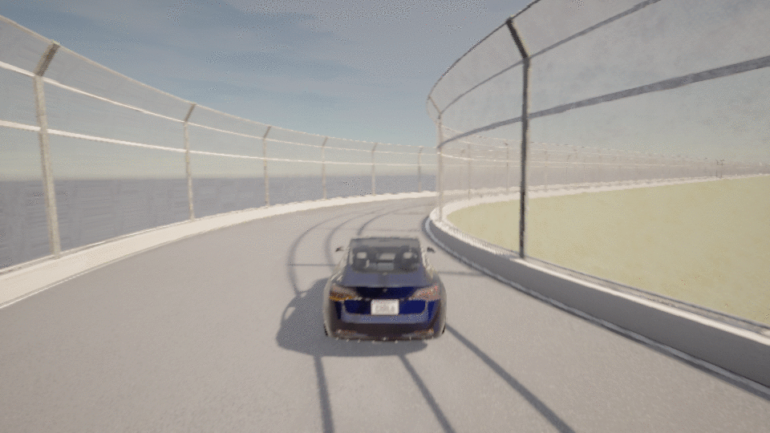
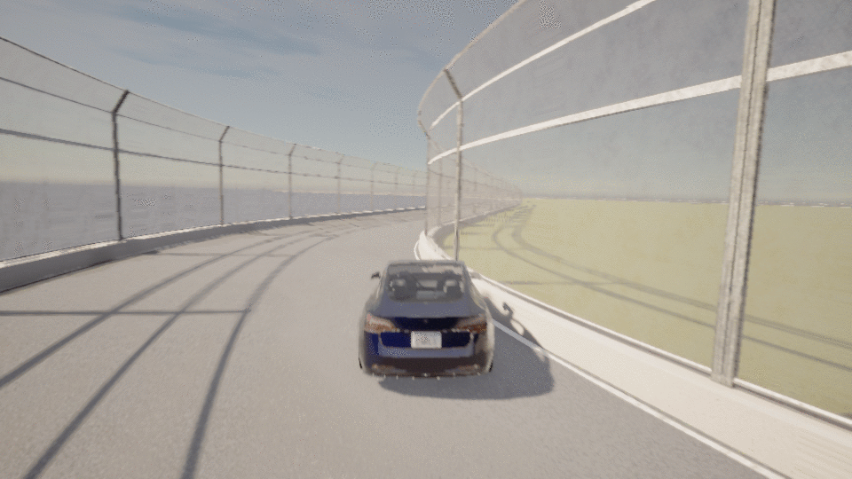
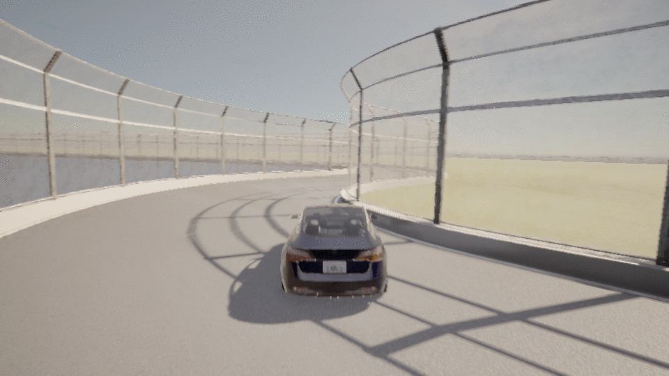
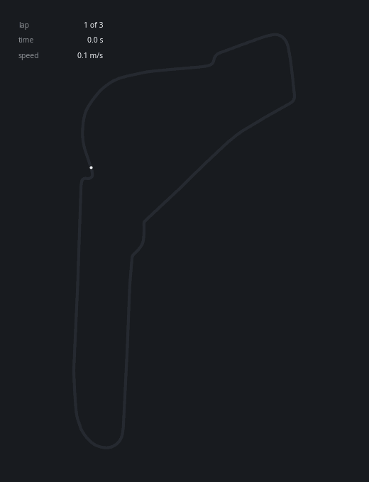
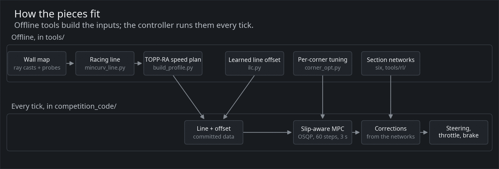
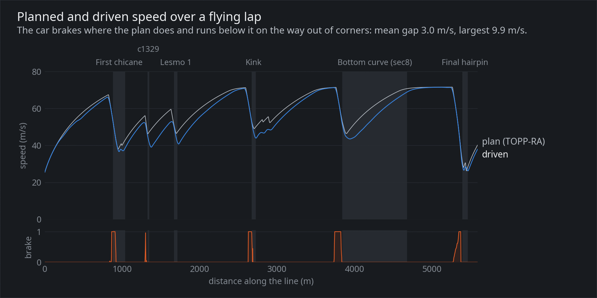
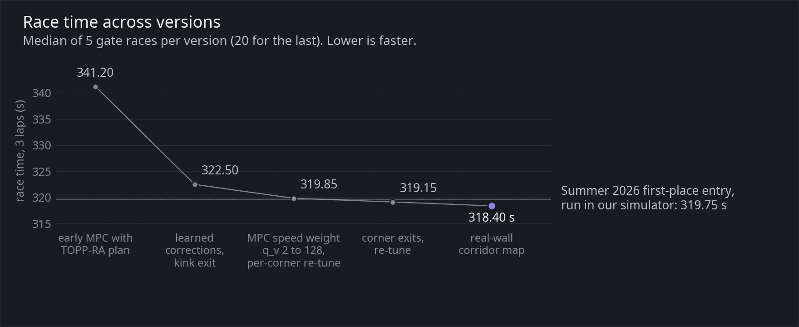

# ROAR Monza entry: slip-aware MPC with learned corrections

A Tesla Model 3 in CARLA 0.9.12 driving three standing-start laps of Monza for the ROAR Fall 2026 Simulation Racing
competition (UC Berkeley). A slip-aware MPC tracks a minimum-curvature racing line at a time-optimal planned speed, and
small learned corrections ride on top.




<sub>Chase camera, rendered by CARLA during one race of this commit (318.40 s, 0 collisions). One frame per 2 s of
simulated time.</sub>

| Car | Laps | Time (median of 20 races) | Range | Collisions | Closest wall (wall map) |
|---|---|---|---|---|---|
| Tesla Model 3 | 3, standing start | **318.40 s** | 318.30 to 318.40 s | 0 in 20 | 0.13 m |

Measured on one machine (Ubuntu, Monza server under GE-Proton 9) with the unmodified `competition_runner.py` and
`infrastructure.py`; Windows is untested. With 20 of 20 races clean, a crash rate as high as about 1 in 7 cannot be
ruled out. The wall distance comes from a map that is ray-cast except at the probed corners
([evidence](#result-and-safety-evidence)).

Competition documentation: [roar.gitbook.io](https://roar.gitbook.io/roar-competition-documentation/). Short run
notes for the organizers: [instruction.txt](instruction.txt).

## Quick start

On a machine where the Monza CARLA server already runs natively (the organizers' Windows setup):

1. Use Python 3.8: carla 0.9.12 has no wheels for later versions.
2. Install ROAR_PY first (it provides `roar_py_interface`, carla and gymnasium), then this repo's packages:
   `pip install -r requirements.txt` (numpy 1.24.4, scipy 1.10.1, osqp 1.1.3).
3. Start the Monza server, then run the unmodified starter runner:
   ```
   cd competition_code
   python competition_runner.py
   ```
4. Expected output: `Solution finished in 318.3... seconds` or `318.4...` (318.30 to 318.40 s), and no `major collision`
   line.

Under Linux and Proton, run `python tools/sim/race.py` from the repo root instead. It runs the same unmodified runner and
only raises the client timeout from 5 s to 120 s, because the first ticks under Proton are slower than 5 s.

The submission is `competition_code/submission.py` with its modules and data. It reads sensors only through
`get_last_gym_observation()`, never calls `receive_observation()` or `world.step()`, never teleports and never reads
anything from `tools/`. Everything it needs is committed in `competition_code/data/`, so nothing is trained or generated
at run time.

## Run on Windows (organizers' setup, not tested by us)

We have not run these steps. We only checked that the packages exist for Windows: carla 0.9.12 has Windows wheels for
Python 3.7 and 3.8, and numpy 1.24.4, scipy 1.10.1 and osqp 1.1.3 have Windows wheels for Python 3.8.
You need 64-bit Python 3.8 (with the `py` launcher) and git.

**1. Map.** Download Monza from https://roar.berkeley.edu/monza-map/ and extract it, for example to
`C:\roar\Monza_V1.1\Monza\` (the folder that contains `CarlaUE4.exe`).

**2. Python environment** (PowerShell):

```powershell
cd C:\roar
py -3.8 -m venv .venv
.\.venv\Scripts\Activate.ps1
git clone https://github.com/augcog/ROAR_PY.git
cd ROAR_PY
pip install -r requirements.txt -e roar_py_core -e roar_py_carla
cd ..
git clone -b main https://github.com/Rudra-roy/ROAR_Competition.git
pip install -r ROAR_Competition\requirements.txt
python -c "import carla, roar_py_interface, osqp, scipy; print('ok')"
```

**3. Server.** Start `C:\roar\Monza_V1.1\Monza\CarlaUE4.exe` and wait until the map has loaded. The runner connects on
port 2000.

**4. Race:**

```powershell
cd C:\roar\ROAR_Competition\competition_code
python competition_runner.py
```

Expected: `Solution finished in 318.3... seconds` or `318.4...` (318.30 to 318.40 s), and no `major collision` line.

### Troubleshooting on Windows

- **`time-out of 5000ms while waiting for the simulator`.** The runner's client waits only 5 s. Start the race after the
  map has loaded. If it still times out, run `python tools\sim\race.py` from `C:\roar\ROAR_Competition`: it runs the same
  unmodified runner with a 120 s timeout (also untested on Windows).
- **PowerShell will not run `Activate.ps1`.** Open `cmd.exe` and use `.venv\Scripts\activate.bat` instead.
- **The server hangs after a stopped race.** If a client is killed mid-race, the server stays in synchronous mode and
  hangs. Close CarlaUE4 and start it again.
- **Server crashes.** We have not seen any on Windows. Under Proton the DX11 path asserts (we pass `-dx12`) and a lowered
  quality level (`-quality-level=Low`) crashes the map because of missing materials, so do not lower the quality level.

## Run on Linux (our setup, GE-Proton 9)

Tested on Ubuntu 22.04, NVIDIA RTX 5060 Ti, X11. Monza ships as a Windows CARLA 0.9.12 build, so the
server runs under GE-Proton 9; the Python client runs natively in a Python 3.8 venv. You need a Vulkan GPU driver
(`vulkaninfo --summary`), git, curl, [uv](https://astral.sh/uv), about 10 GB of disk and about 3 GB of free RAM per
running server. No sudo or Steam.

The scripts assume this layout (each path can be overridden, see below):

```
~/Documents/roar_racing/
├── .venv/              Python 3.8 venv (step 2)
├── ROAR_PY/            git clone of augcog/ROAR_PY
├── ROAR_Competition/   this repo, branch main
└── Monza_V1.1/Monza/   the extracted map (contains CarlaUE4.exe, CarlaUE4/, Engine/)
~/tools/GE-Proton9-27/  Proton
~/tools/pfx/            Proton prefix (created on first launch)
```

**1. Map and Proton.** Download Monza from https://roar.berkeley.edu/monza-map/ and extract it to
`~/Documents/roar_racing/Monza_V1.1/Monza/`. Then install GE-Proton 9 (10 and 11 need glibc 2.38 and fail on
Ubuntu 22.04):

```bash
mkdir -p ~/tools/pfx && cd ~/tools
curl -LO https://github.com/GloriousEggroll/proton-ge-custom/releases/download/GE-Proton9-27/GE-Proton9-27.tar.gz
tar xf GE-Proton9-27.tar.gz && rm GE-Proton9-27.tar.gz
```

**2. Python environment** (carla 0.9.12 wheels exist only for Python 3.8 and older):

```bash
cd ~/Documents/roar_racing
git clone https://github.com/augcog/ROAR_PY.git
git clone -b main https://github.com/Rudra-roy/ROAR_Competition.git
uv venv --python 3.8 .venv
source .venv/bin/activate
(cd ROAR_PY && uv pip install -r requirements.txt -e roar_py_core -e roar_py_carla)
uv pip install -r ROAR_Competition/requirements.txt
python -c "import carla, roar_py_interface, osqp, scipy; print('ok')"
```

`requirements.txt` pins what the submission needs (numpy 1.24.4, scipy 1.10.1, osqp 1.1.3; osqp must be 1.x). carla
0.9.12 and gymnasium 0.28.1 come from ROAR_PY.

**3. Server.** Start it outside the venv (Proton needs the system Python 3.9 or newer) and wait for port 2000:

```bash
cd ~/Documents/roar_racing/ROAR_Competition
deactivate 2>/dev/null; tools/sim/run_monza.sh &           # opens a 1280x720 CarlaUE4 window
until ss -ltn | grep -q ':2000 '; do sleep 2; done          # about 10-30 s
```

**4. Race:**

```bash
source ../.venv/bin/activate
python tools/sim/race.py                                    # ROAR_HUD=1 adds a speed/lap/progress overlay
```

`tools/sim/race.py` runs the unmodified `competition_runner.py`. It only raises the CARLA client timeout from 5 s to
120 s. The sim runs in synchronous mode, so wall-clock speed does not change the score. Expected:
`Solution finished in 318.3... seconds` or `318.4...` (318.30 to 318.40 s), and no `major collision` line. Stop the
server afterwards: `WINEPREFIX=~/tools/pfx/pfx ~/tools/GE-Proton9-27/files/bin/wineserver -k`.

<details>
<summary>Five-race check, parallel races, path overrides, tests</summary>

`tools/eval.sh` starts a server, races, kills the server, and repeats:

```bash
ROAR_SERVER_ARGS=-RenderOffScreen tools/eval.sh 5 check    # appends git_sha,label,run,sim_time_s,collisions,status
cat results.csv                                             # to results.csv; logs in logs/check_N.*
```

To race in parallel (one server per slot on port 2000+3·slot, offscreen; leave about 3 GB of RAM per slot):
`tools/eval_slot.sh <slot> <checkout dir> <label>` prints `label,sim_time,collisions,status`, for example
`for k in 1 2 3 4; do tools/eval_slot.sh $k . run_$k & sleep 25; done; wait`.

Paths can be overridden with `ROAR_MONZA` (map folder), `ROAR_PROTON` (Proton folder), `ROAR_PFX` (prefix) and
`ROAR_VENV` (venv, default `../.venv`).

Development tools and tests (not needed to race): `uv pip install -r ROAR_Competition/requirements-dev.txt`, then
`PYTHONPATH= python -m pytest tests/ -q` from the repo root (166 tests, about 5 minutes).

</details>

### Troubleshooting on Linux

- **The server asserts or the map crashes.** Use `-dx12` (already set in `run_monza.sh`; DX11 asserts) and never
  `-quality-level=Low` (missing materials crash the map).
- **`time-out of 5000ms while waiting for the simulator`.** Run through `tools/sim/race.py`, not the runner directly.
- **The server hangs after a stopped race.** A client killed mid-race leaves the server in synchronous mode. Stop it with
  `wineserver -k` as above and start again.
- **The server exits right after the Steam lines in its log.** It needs a display (`DISPLAY` set), even with
  `-RenderOffScreen`: without one it prints "DX12 is not supported on your system" and quits.
- **Server logs:** `Monza_V1.1/Monza/CarlaUE4/Saved/Logs/CarlaUE4.log`.

## Result and safety evidence

**Gate.** 20 full races of the committed setup with `tools/gate.py` (slot checkouts verified byte-identical, 4 of the
20 with the server window open): 318.30 to 318.40 s, median 318.40 s, 0 collisions. The gate records the closest wall
approach of every race. The car body never came closer than 0.13 m to a wall on the wall map. Cars that crashed in our
tests touched at 0.0 to 0.1 m.

**Wall map.** Ray-cast from the centreline, with collision-probe edges at the inside of Lesmo 1, the final hairpin, c1329,
the first-chicane exit and the kink. Elsewhere the walls are ray-cast only. The rays miss the lower part of some fences
by 0.1 to 0.25 m, which is why the probed spots were corrected.

**The car's own poses, probed** (static, simulator collision mesh):

| Where | Closest touch |
|---|---|
| Final hairpin apex | 0.18 m |
| Lesmo 1 | 0.26 m |
| c1329 | 0.26 m |
| First-chicane exit | 0.26 m |
| Kink | 0.40 m |
| Bottom curve (sec8) | none within 0.6 m |

Outside walls: 0.60 m at Lesmo 1 and 0.75 m at the hairpin.

<table>
<tr>
<td valign="top"></td>
<td valign="top">
<br><sub>First-chicane exit</sub><br>
<br><sub>Lesmo 1</sub><br>
<br><sub>Final hairpin</sub>
</td>
</tr>
</table>

<sub>Map and stills are from the same race (318.40 s, 0 collisions); the stills are chase-camera frames from the
second lap.</sub>

<details>
<summary>Top-down replay of the race from its telemetry</summary>



</details>

## How it works



### 1. Racing line

A minimum-curvature line (`tools/mincurv_line.py`), widened corner by corner. The waypoint polygon
is not the real wall layout (fences and obstacles sit inside it), so the room is bounded by what was measured:
first the space cars have driven without contact, and at Lesmo 1 and the final hairpin the real walls
(`--corridor`, below). At the diagonal kink, the bottom curve (sec8) and the first chicane the curvature cost
also rises from the apex to the exit (`--exit-weight`, `SHIP_EXIT_STEPS`), so the line does its turning early and
runs straighter where the car is on full power (0.45 + 0.25 + 0.05 s per race).

<details>
<summary>How the wall map was built</summary>

**Real walls** (`tools/map_corridor.py` -> `tools/corridor_map.npz`): ray casts sideways from the centreline every
metre, corrected with `tools/probe_obstacle.py`, which teleports the car through a recorded race's poses shifted
toward the corner's inside and finds the first touch with the simulator's own collision mesh (the rays miss
the lower part of some fences by 0.1-0.25 m; crash replays touch at 0.0-0.1 m, so the probe is validated).
`tools/correct_corridor.py` merges probe results into the map. The line's bounds are the wall minus the car
body's measured reach (slides included) minus a gap (`SHIP_CORRIDOR_WINDOWS` in `mincurv_line.py`).

</details>

### 2. Speed plan

TOPP-RA over the line with per-section lateral grip, a fitted drive-force limit and braking that
shares grip with cornering (friction ellipse), offline in `tools/build_profile.py`.



Planned and driven speed over one lap; the brake channel shows where the car brakes. The car brakes where the plan does
and runs below it while accelerating out of corners (mean gap 3.0 m/s on this lap, largest 9.9 m/s just after c1329).
According to our experiment log the gap comes from the plan's inflated per-section grip settings, not from a model
error.

### 3. Controller: slip-aware MPC

A linear time-varying MPC (OSQP, 60 steps,
3 s) on a dynamic bicycle model with saturating tyres and braking load transfer, fitted to race logs
(`tools/fit_tyres.py`). It tracks the line's course rather than the car's nose, limits tyre slip angles, and
shrinks its braking limit as cornering load rises, so it brakes in a straight line and turns while easing off.
Its speed weight (`mpc.q_v` = 128) makes it hold the planned speed through corners: with the earlier weight of 2
it traded speed for line accuracy and ran 3-9 m/s below the plan in every corner (2.3 s per race).
`competition_code/mpc.py` is the earlier kinematic MPC, kept as an alternative (`mpc.model`). The code is
`competition_code/tyre_mpc.py`.

### 4. Learned line offset

(`tools/ilc.py`). Iterative learning over repeated laps: the car's measured lateral error
at each metre of the lap is fed back into the reference, so the driven path lands on the intended line.

### 5. Per-corner tuning

(`tools/corner_opt.py`, `tools/grid_race.py`). Mid-corner throttle floor (so the driven
wheels keep pulling instead of engine-braking the rear loose), braking strength and corner grip, optimised per
section by racing four simulations in parallel. A change is kept only if the car's body (its four corners from
the logged heading, not just its centre) stays within the body positions of earlier clean races
(`tools/body_margin.py`, `corner_opt.py --body-ref`), or with `--walls` stays at least `--wall-min` (0.10 m) from
the measured walls: sliding harder through Lesmo was faster but swept the body 0.3-0.4 m further inside, and one
such run hit the apex.

### 6. Learned corrections

(`tools/rl/`). Six small neural networks, one per section of the lap, add bounded
corrections to the MPC's steering and acceleration (at most 0.03 rad and 4 m/s²). They were trained with
evolution strategies on continuous flying laps in the simulator, each graded on its own section's time, crashes
and near-misses. Only the sections whose networks proved faster in full races are active; the others output zero.
At run time they are a few hundred numbers evaluated with numpy.

## Data files

All in `competition_code/data/`, committed:

| File | What it is |
|---|---|
| `racing_line.npz` | the racing line (points + its spline) |
| `speed_profile.npz` | the time-optimal speed plan along the line (TOPP-RA, 3 laps from a standing start) |
| `line_offset.npz` | a learned lateral offset of the line, per metre (see below) |
| `vehicle_params.json` | fitted car model: pedal map, steering, tyres, per-corner grip, braking and throttle settings, controller weights |
| `residual.npz` | learned per-section correction networks (see below) |
| `centreline.npy` | track centreline (used by the tools, not loaded at run time) |

## Lap time history



Each point is the median of that version's gate races (5, and 20 for the last), from our experiment log. The step
labelled in the figure is the MPC's speed weight (`mpc.q_v` 2 to 128, see
[the controller](#3-controller-slip-aware-mpc)), together with the per-corner re-tune. The benchmark line is the Summer
2026 first-place entry's car, run in our simulator.

## What did not work

- **A low MPC speed weight.** With `mpc.q_v` = 2 the controller traded speed for line accuracy and ran 3 to 9 m/s below
  the plan in every corner (2.3 s per race).
- **Sliding harder through Lesmo.** It was faster but swept the car body 0.3 to 0.4 m further inside, and one such run hit
  the apex. Changes are now kept only if the body stays inside earlier clean races or clear of the measured walls.
- **The waypoint polygon as walls.** Fences and obstacles sit inside it, so it cannot bound the line.
- **Ray casts alone.** They miss the lower part of some fences by 0.1 to 0.25 m. The collision probe corrects them.
- **Networks in every section.** Only the sections whose networks proved faster in full races are active; the others
  output zero. Networks tuned on flying laps alone did not carry over to full races.
- **Braking harder from the measured pedal map.** The car cannot brake that hard while cornering; the race got slower.

## Repository layout

- `competition_code/` the submission (runner and infrastructure unchanged from upstream).
- `tools/sim/` the Linux server launcher (`run_monza.sh`) and race wrapper (`race.py`).
- `tools/` development tools: car-model fitting, line and speed-plan generation, the learning loops, race
  evaluation (`eval.sh`, `race_guard.sh`, `eval_slot.sh` for parallel simulator slots), analysis.
- `tools/capture.py`, `tools/make_media.py`, `tools/media_data.py`, `tools/pick_stills.py` draw the images below
  `docs/img/` from one logged race (camera frames recorded beside a race; telemetry from its `run.csv`).
- `docs/img/` the README's images and animations.
- `LICENSE` MIT.
- `tests/` unit tests: `PYTHONPATH= python -m pytest tests/ -q` (about 5 minutes; needs `requirements-dev.txt`).

## Limits

- One machine: Ubuntu 22.04 with the Monza server under GE-Proton 9. Results elsewhere are untested, and the Windows
  steps above have not been run by us.
- 20 of 20 clean races bound the crash rate only to about 1 in 7.
- The wall map is ray-cast except at the probed spots listed above.
- 4 of the 20 gate races had the server window open. The simulation is synchronous, so wall-clock
  speed does not change the score.
- The tests badge is static: `PYTHONPATH= python -m pytest tests/ -q` (166 tests, about 5 minutes, needs
  `requirements-dev.txt`).

## Licence

MIT, see [LICENSE](LICENSE). It covers our code and data. `competition_runner.py` and `infrastructure.py` are the
ROAR team's unmodified starter files, and the repositories named in Credits carry no licence of their own.

## Credits

- The racing line was first built from the line of the Summer 2026 first-place entry
  (github.com/micahc123/roar2026), itself built on github.com/MightyMark3/ROAR_1_S25. The corner widening used the
  path that ROAR_1_S25's car drove in our simulator (recorded telemetry) as evidence of where the road is clear.
  No code from either repository is included. Neither carries a licence, so we credit the authors here and
  disclose this use to the organizers with the submission. The same was done with the recorded path of the Summer
  2026 first-place entry's car in our simulator (telemetry only): it is part of the driven-path evidence for the exit
  steps of the line (`--winner`) and the benchmark the lap was compared against section by section. The wall map and
  the obstacle probe use only our own simulator runs.
- ROAR_PY, CARLA and the competition starter code: the ROAR team at UC Berkeley.
